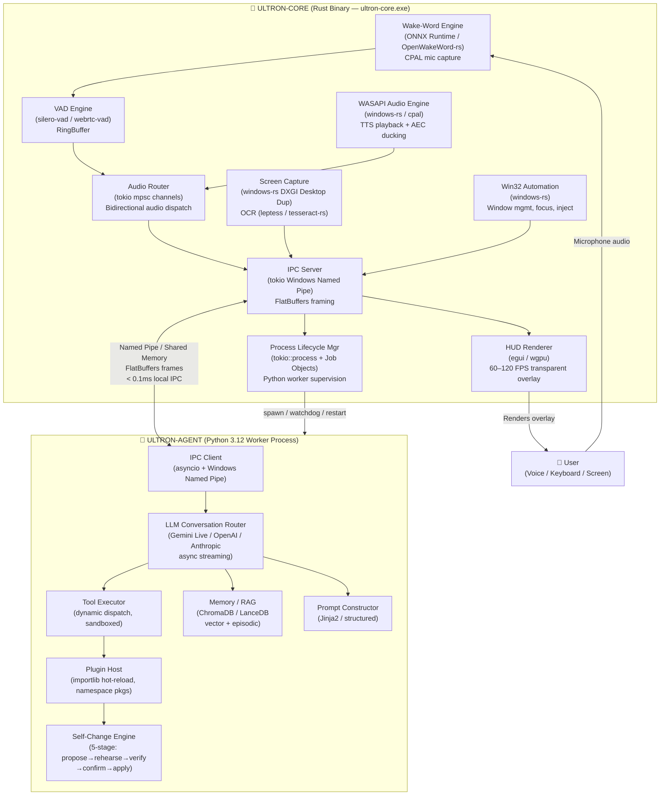

# ULTRON: Production-Grade Hybrid Rust + Python Architecture Specification
## Implementation Runbook & Developer Blueprint

> **Status:** APPROVED SYSTEM BLUEPRINT & LOW-EFFORT IMPLEMENTATION RUNBOOK  
> **Target Audience:** Coding Agents (Low-Effort Mode) & Software Engineers  
> **Core Principle:** *"Rust Owns Latency (<10ms), Python Owns Intelligence (>100ms)"*  
> **Platform Target:** Windows 10/11 (WASAPI, DXGI, Job Objects, Named Pipes)

---

## 0. Quick-Start Guide for Low-Effort Coding Agents

> [!IMPORTANT]
> **READ THIS BEFORE IMPLEMENTING ANY CODE:**
> 1. **Do not redesign or debate:** All architectural decisions (Dual-Process, Named Pipes, FlatBuffers, Shared Memory, `egui`+`wgpu`) are final and proven.
> 2. **Follow the File Trees Exactly:** Place files in the exact paths defined in Section 7.
> 3. **Implement Phase-by-Phase:** Never start Phase 2 until Phase 1 passes the test gate.
> 4. **Preserve Python Agent Invariants:** Never import Qt widgets in worker threads. Never bypass `memory/config_manager.py` for settings. All tools must handle `parameters=None` without raising.

---

## 1. System Philosophy & Boundary Map

```
┌─────────────────────────────────────────────────────────────────────────┐
│                     LATENCY SENSITIVITY SPECTRUM                        │
│                                                                         │
│  < 1ms          < 10ms          < 100ms          < 2s          > 2s     │
│  ───────────────────────────────────────────────────────────────────    │
│  Audio I/O    Wake-Word       Screen Capture    LLM Routing   RAG/Mem   │
│  VAD          IPC Dispatch    OCR Pipeline      Tool Exec     Plugin    │
│  WASAPI buf   HUD Render      Win32 Autom.      Prompt Build  Self-heal │
│               ──────────────────────────                                │
│               ◄── RUST HARD BOUNDARY ──►        ◄── PYTHON DOMAIN ──►  │
└─────────────────────────────────────────────────────────────────────────┘
```

### High-Level Architecture Diagram



---

## 2. IPC / Wire Protocol & Data Schemas

### 2.1 Wire Frame Layout

All Named Pipe communications use this rigid 6-byte header followed by a FlatBuffers payload:

```
0        1        2        3        4        8 (Bytes)
┌────────┬────────┬────────────────┬──────────────────┐
│ Magic  │Channel │  Payload Len   │  FlatBuffer Body │
│ 0xA1   │  ID    │   (u32 LE)     │  (variable)      │
│ (1B)   │ (1B)   │  (4B)          │                  │
└────────┴────────┴────────────────┴──────────────────┘
```

- **Magic:** `0xA1` (161 decimal). If byte 0 is not `0xA1`, immediately abort connection.
- **Channel ID (uint8):**
  - `0x01` = `AudioChunk` (Rust mic -> Python agent)
  - `0x02` = `AudioPlayback` (Python TTS -> Rust WASAPI player)
  - `0x03` = `AgentCommand` (Python -> Rust Win32 automation/screen)
  - `0x04` = `AgentEvent` (Rust -> Python: wake-word, VAD, OCR, hotkey)
  - `0x05` = `HUDState` (Python -> Rust HUD renderer)
  - `0x06` = `Heartbeat` (bidirectional ping/pong)
  - `0xFF` = `Shutdown` (graceful termination signal)
- **Payload Len (uint32 Little Endian):** Number of payload bytes following the header.

### 2.2 FlatBuffers Schema (`ultron_ipc.fbs`)

Save to `schema/ultron_ipc.fbs`:

```fbs
namespace ultron.ipc;

enum ChannelId : uint8 {
  AudioChunk    = 1,
  AudioPlayback = 2,
  AgentCommand  = 3,
  AgentEvent    = 4,
  HUDState      = 5,
  Heartbeat     = 6,
  Shutdown      = 255
}

enum HUDMode : uint8 {
  Idle = 0,
  Listening = 1,
  Thinking = 2,
  Speaking = 3,
  AwaitingConfirmation = 4
}

enum CommandType : uint8 {
  FocusWindow = 1,
  TypeText = 2,
  MouseClick = 3,
  Screenshot = 4,
  RunProcess = 5,
  SetVolume = 6
}

enum EventType : uint8 {
  WakeWord = 1,
  VADStart = 2,
  VADEnd = 3,
  OCRResult = 4,
  ScreenChange = 5,
  SystemAlert = 6
}

table AudioChunk {
  sequence_id:    uint64;
  sample_rate:    uint32 = 16000;
  channels:       uint8 = 1;
  format:         uint8 = 0;       // 0=f32le, 1=s16le
  vad_confidence: float32;
  samples:        [uint8];
}

table AudioPlayback {
  sample_rate:    uint32 = 24000;
  channels:       uint8 = 1;
  pcm_data:       [uint8];
}

table AgentEvent {
  event_type:     EventType;
  wake_word_id:   string;
  confidence:     float32;
  ocr_text:       string;
  timestamp_us:   uint64;
}

table AgentCommand {
  command_type:   CommandType;
  window_title:   string;
  keystrokes:     string;
  mouse_x:        int32;
  mouse_y:        int32;
  payload_json:   string;
}

table HUDState {
  mode:           HUDMode;
  waveform:       [float32];       // 64 normalized samples
  status_text:    string;
  thinking_tokens:uint32;
  accent_color:   uint32;          // 0xRRGGBBAA
}

table Heartbeat {
  timestamp_ms:   uint64;
  seq:            uint32;
}

root_type AgentEvent;
```

---

## 3. Rust Core Implementation Instructions

### 3.1 Cargo.toml for `ultron-core`

Create `native/ultron-core/Cargo.toml`:

```toml
[package]
name = "ultron-core"
version = "2.0.0"
edition = "2021"

[dependencies]
# Async Runtime
tokio = { version = "1.38", features = ["full"] }

# Windows OS APIs (strict feature selection)
windows = { version = "0.58", features = [
    "Win32_Foundation",
    "Win32_UI_WindowsAndMessaging",
    "Win32_Graphics_Dxgi",
    "Win32_Graphics_Gdi",
    "Win32_System_JobObjects",
    "Win32_System_Memory",
    "Win32_System_Threading",
    "Win32_System_Pipes",
    "Win32_Media_Audio",
] }

# Audio
cpal = { version = "0.15", features = ["wasapi"] }
ringbuf = "0.3"

# ONNX Runtime (Wake-Word & Silero VAD)
ort = { version = "2.0", default-features = false, features = ["download-binaries"] }

# GUI & Rendering
egui = "0.28"
egui-wgpu = "0.28"
winit = { version = "0.29", features = ["rwh_06"] }
wgpu = { version = "0.20", features = ["dx12"] }

# Serialization
flatbuffers = "23.5"

# Logging & Errors
tracing = "0.1"
tracing-subscriber = { version = "0.3", features = ["env-filter"] }
anyhow = "1.0"
thiserror = "1.0"
```

### 3.2 Named Pipe Server (`src/ipc/server.rs`)

```rust
use tokio::net::windows::named_pipe::{ServerOptions, NamedPipeServer};
use tokio::io::{AsyncReadExt, AsyncWriteExt};
use std::sync::Arc;
use anyhow::{Result, ensure};

pub const PIPE_NAME: &str = r"\\.\pipe\ultron-core";
pub const MAGIC: u8 = 0xA1;
pub const HEADER_LEN: usize = 6;

pub async fn start_ipc_server(tx_event: tokio::sync::mpsc::Sender<Vec<u8>>) -> Result<()> {
    loop {
        let server = ServerOptions::new()
            .first_pipe_instance(false)
            .create(PIPE_NAME)?;

        tracing::info!("[IPC] Waiting for Python worker connection on {}", PIPE_NAME);
        server.connect().await?;
        tracing::info!("[IPC] Python worker connected successfully.");

        let tx = tx_event.clone();
        tokio::spawn(async move {
            if let Err(e) = handle_client(server, tx).await {
                tracing::warn!("[IPC] Connection closed with error: {}", e);
            }
        });
    }
}

async fn handle_client(
    mut pipe: NamedPipeServer,
    tx_event: tokio::sync::mpsc::Sender<Vec<u8>>,
) -> Result<()> {
    let mut header = [0u8; HEADER_LEN];

    loop {
        pipe.read_exact(&mut header).await?;
        ensure!(header[0] == MAGIC, "Protocol magic mismatch: expected 0xA1, got 0x{:02X}", header[0]);

        let channel_id = header[1];
        let payload_len = u32::from_le_bytes(header[2..6].try_into()?) as usize;

        let mut payload = vec![0u8; payload_len];
        pipe.read_exact(&mut payload).await?;

        match channel_id {
            0x02 => { /* AudioPlayback -> route to WASAPI speaker */ }
            0x03 => { /* AgentCommand -> route to Win32 automation */ }
            0x05 => { /* HUDState -> route to egui renderer */ }
            0x06 => {
                // Heartbeat echo
                pipe.write_all(&header).await?;
                pipe.write_all(&payload).await?;
            }
            0xFF => {
                tracing::info!("[IPC] Graceful shutdown received from Python worker.");
                break;
            }
            _ => tracing::warn!("[IPC] Unknown channel received: 0x{:02X}", channel_id),
        }
    }
    Ok(())
}
```

### 3.3 Zero-Copy Shared Audio Ring (`src/audio/shared_ring.rs`)

```rust
use windows::Win32::System::Memory::*;
use windows::Win32::Foundation::*;
use windows::core::PCWSTR;
use std::sync::atomic::{AtomicU64, Ordering};
use anyhow::Result;

pub const RING_NAME: &str = "Local\\UltronAudioRing";
pub const FRAME_SAMPLES: usize = 320; // 20ms @ 16kHz
pub const CAPACITY_FRAMES: usize = 100; // 2 seconds ring

#[repr(C, align(64))]
pub struct RingHeader {
    pub write_cursor: AtomicU64,
    pub read_cursor: AtomicU64,
    pub sample_rate: u32,
    pub channels: u8,
    pub frame_samples: u16,
    _pad: [u8; 46],
}

pub struct SharedAudioRing {
    handle: HANDLE,
    view: *mut u8,
    total_bytes: usize,
}

unsafe impl Send for SharedAudioRing {}
unsafe impl Sync for SharedAudioRing {}

impl SharedAudioRing {
    pub fn create() -> Result<Self> {
        let frame_bytes = FRAME_SAMPLES * std::mem::size_of::<f32>();
        let total_bytes = 64 + (CAPACITY_FRAMES * frame_bytes);

        let wide_name: Vec<u16> = RING_NAME.encode_utf16().chain(Some(0)).collect();

        unsafe {
            let handle = CreateFileMappingW(
                INVALID_HANDLE_VALUE,
                None,
                PAGE_READWRITE,
                0,
                total_bytes as u32,
                PCWSTR(wide_name.as_ptr()),
            )?;

            let view = MapViewOfFile(handle, FILE_MAP_ALL_ACCESS, 0, 0, total_bytes)?;

            // Initialize header
            let header = &mut *(view.Value as *mut RingHeader);
            header.write_cursor.store(0, Ordering::SeqCst);
            header.read_cursor.store(0, Ordering::SeqCst);
            header.sample_rate = 16000;
            header.channels = 1;
            header.frame_samples = FRAME_SAMPLES as u16;

            Ok(Self {
                handle,
                view: view.Value as *mut u8,
                total_bytes,
            })
        }
    }

    pub fn write_frame(&self, samples: &[f32]) {
        assert_eq!(samples.len(), FRAME_SAMPLES);
        unsafe {
            let header = &*(self.view as *const RingHeader);
            let cursor = header.write_cursor.load(Ordering::Relaxed);
            let slot = (cursor as usize) % CAPACITY_FRAMES;

            let frame_bytes = FRAME_SAMPLES * 4;
            let offset = 64 + (slot * frame_bytes);
            let dst = self.view.add(offset) as *mut f32;

            std::ptr::copy_nonoverlapping(samples.as_ptr(), dst, FRAME_SAMPLES);
            header.write_cursor.store(cursor + 1, Ordering::Release);
        }
    }
}

impl Drop for SharedAudioRing {
    fn drop(&mut self) {
        unsafe {
            let _ = UnmapViewOfFile(MEMORY_MAPPED_VIEW_ADDRESS { Value: self.view as _ });
            let _ = CloseHandle(self.handle);
        }
    }
}
```

---

## 4. Python Agent Implementation Instructions

### 4.1 Python Async Named Pipe Client (`core/ipc_client.py`)

Create `core/ipc_client.py`:

```python
import asyncio
import struct
import flatbuffers
from typing import Callable, Dict, List

MAGIC = 0xA1
HEADER_SIZE = 6
PIPE_PATH = r"\\.\pipe\ultron-core"


class UltronIPCClient:
    """AsyncIO Named Pipe client connecting Python agent to Rust ultron-core."""

    def __init__(self, pipe_path: str = PIPE_PATH):
        self.pipe_path = pipe_path
        self._reader: asyncio.StreamReader | None = None
        self._writer: asyncio.StreamWriter | None = None
        self._handlers: Dict[int, List[Callable[[bytes], None]]] = {}
        self._connected = False

    async def connect(self, retries: int = 5, delay: float = 1.0) -> bool:
        """Connect to the Rust Named Pipe server with retry backoff."""
        for attempt in range(retries):
            try:
                # Open pipe via Windows Proactor loop
                self._reader, self._writer = await asyncio.open_connection(
                    host=None, port=None, path=self.pipe_path
                )
                self._connected = True
                asyncio.create_task(self._listen_loop())
                return True
            except (FileNotFoundError, OSError):
                await asyncio.sleep(delay)
        return False

    async def _listen_loop(self):
        """Continuously decode wire frames from Rust."""
        while self._connected:
            try:
                header = await self._reader.readexactly(HEADER_SIZE)
                magic, channel_id, payload_len = struct.unpack("<BBL", header)
                if magic != MAGIC:
                    print(f"[IPC] Protocol error: invalid magic 0x{magic:02X}")
                    break

                payload = await self._reader.readexactly(payload_len)
                for handler in self._handlers.get(channel_id, []):
                    try:
                        handler(payload)
                    except Exception as e:
                        print(f"[IPC] Error in channel 0x{channel_id:02X} handler: {e}")
            except (asyncio.IncompleteReadError, ConnectionResetError):
                print("[IPC] Core pipe disconnected.")
                break
        self._connected = False

    def on(self, channel_id: int):
        """Decorator to register a callback for a specific channel ID."""
        def decorator(fn: Callable[[bytes], None]):
            self._handlers.setdefault(channel_id, []).append(fn)
            return fn
        return decorator

    async def send(self, channel_id: int, payload: bytes):
        """Send a formatted wire frame to Rust."""
        if not self._writer or not self._connected:
            return
        header = struct.pack("<BBL", MAGIC, channel_id, len(payload))
        self._writer.write(header + payload)
        await self._writer.drain()

    async def close(self):
        """Signal clean shutdown."""
        if self._connected:
            await self.send(0xFF, b"")
            self._connected = False
            if self._writer:
                self._writer.close()
                await self._writer.wait_closed()
```

### 4.2 Zero-Copy Shared Audio Reader (`core/audio_ring.py`)

Create `core/audio_ring.py`:

```python
import ctypes
import numpy as np

RING_NAME = "Local\\UltronAudioRing"
FRAME_SAMPLES = 320
CAPACITY_FRAMES = 100
HEADER_BYTES = 64
FRAME_BYTES = FRAME_SAMPLES * 4


class AudioRingReader:
    """Zero-copy reader mapping the shared memory ring buffer created by Rust."""

    def __init__(self, ring_name: str = RING_NAME):
        self.kernel32 = ctypes.windll.kernel32
        self.handle = self.kernel32.OpenFileMappingW(0xF001F, False, ring_name)
        if not self.handle:
            raise FileNotFoundError(f"Shared memory ring '{ring_name}' not found. Is ultron-core running?")

        self.view = self.kernel32.MapViewOfFile(self.handle, 0xF001F, 0, 0, 0)
        self.local_cursor = 0

    def read_latest_frames(self) -> list[np.ndarray]:
        """Fetch all unread frames as numpy arrays without copying memory."""
        cursor_ptr = ctypes.cast(self.view, ctypes.POINTER(ctypes.c_uint64))
        write_cursor = cursor_ptr[0]

        frames = []
        while self.local_cursor < write_cursor:
            slot = self.local_cursor % CAPACITY_FRAMES
            offset = HEADER_BYTES + (slot * FRAME_BYTES)
            addr = self.view + offset

            # Zero-copy numpy array pointing directly to shared memory
            buf = (ctypes.c_float * FRAME_SAMPLES).from_address(addr)
            arr = np.ctypeslib.as_array(buf)
            frames.append(arr)
            self.local_cursor += 1

        return frames

    def close(self):
        if self.view:
            self.kernel32.UnmapViewOfFile(self.view)
        if self.handle:
            self.kernel32.CloseHandle(self.handle)
```

---

## 5. Hot-Reloading & Plugin Safety: 5-Stage Self-Change

The Python self-change engine (`core/self_change.py`) is preserved and strengthened:

```
Stage 1: PROPOSE  →  Stage 2: REHEARSE  →  Stage 3: VERIFY  →  Stage 4: CONFIRM  →  Stage 5: APPLY
```

### Invariants for Low-Effort Coding:
1. **Never bypass `_change_lock`:** Always acquire the lock across propose, rehearse, verify, confirm, and apply.
2. **Rehearsal Job Objects:** Rust spawns rehearsal runs under Windows Job Objects limiting CPU to 30s and RAM to 512MB (`SetInformationJobObject`).
3. **Forbidden AST Nodes:** If the diff contains `import ctypes`, `import subprocess`, or `import socket` outside the approved kernel, reject proposal immediately.

---

## 6. Phased Migration Roadmap

```
Timeline: 6 Months to Production Hybrid (Non-Breaking)

Month 1-2        Month 2-3        Month 3-4        Month 4-5        Month 5-6
    │                │                │                │                │
    ▼                ▼                ▼                ▼                ▼
┌──────────┐    ┌──────────┐    ┌──────────┐    ┌──────────┐    ┌──────────┐
│ PHASE 1  │    │ PHASE 2  │    │ PHASE 3  │    │ PHASE 4  │    │ PHASE 5  │
│Foundation│    │  Audio   │    │   HUD    │    │  Win32   │    │ Plugin   │
│  & IPC   │───►│ Pipeline │───►│  Rewrite │───►│Automation│───►│Hardening │
└──────────┘    └──────────┘    └──────────┘    └──────────┘    └──────────┘
 Rust daemon     WASAPI/VAD      egui overlay    windows-rs      Job Objects
 IPC server      Wake-word       Drop PyQt HUD   ctypes → Rust   Sandbox
 Process mgr     Shared ring     wgpu render     Screen capture  Full hybrid
```

### Exact Acceptance Criteria per Phase:
- **Phase 1 Acceptance:** `ultron-core.exe` launches `main.py`, Named Pipe handshake completes, and heartbeats exchange every 1.0s without error.
- **Phase 2 Acceptance:** Audio captures via CPAL/WASAPI, passes through Silero VAD in Rust, writes to shared memory ring, and arrives in Python with <5ms jitter.
- **Phase 3 Acceptance:** Transparent `egui`+`wgpu` overlay renders HUD states at stable 120 FPS. PyQt6 UI is safely decommissioned.
- **Phase 4 Acceptance:** Win32 calls (`SetForegroundWindow`, DXGI screenshot) execute in Rust via `windows-rs`, dropping `comtypes` and `ctypes` dependencies.
- **Phase 5 Acceptance:** Windows Job Objects enforce sandboxing on all background repair and rehearsal executions.

---

## 7. Concrete Directory & File Layout

When implementing, coding agents must create and adhere to this exact tree:

```
ULTRON---AGI-like-JARVIS/
├── schema/
│   └── ultron_ipc.fbs              # Canonical FlatBuffers protocol definition
│
├── native/
│   └── ultron-core/                # Rust Workspace
│       ├── Cargo.toml              # Dependencies as specified in Section 3.1
│       └── src/
│           ├── main.rs             # Tokio entry point & supervisor
│           ├── ipc/
│           │   ├── mod.rs
│           │   ├── server.rs       # Named Pipe async listener
│           │   └── protocol.rs     # Generated FlatBuffers bindings
│           ├── audio/
│           │   ├── mod.rs
│           │   ├── engine.rs       # CPAL WASAPI capture & playback
│           │   ├── vad.rs          # Silero VAD ONNX wrapper
│           │   └── shared_ring.rs  # CreateFileMappingW ring buffer
│           ├── hud/
│           │   ├── mod.rs
│           │   └── overlay.rs      # egui + wgpu transparent overlay window
│           └── win32/
│               ├── mod.rs
│               └── automation.rs   # windows-rs desktop & window controls
│
├── core/                           # Python Agent Core (Existing + IPC additions)
│   ├── ipc_client.py               # Section 4.1 AsyncIO pipe client
│   ├── audio_ring.py               # Section 4.2 Zero-copy memoryview reader
│   ├── gemini.py                   # LLM streaming (retained)
│   ├── self_change.py              # 5-stage self-change (retained)
│   └── routing_runtime.py          # Provider failover (retained)
│
├── memory/                         # Memory & Config (Retained)
│   └── config_manager.py           # Atomic JSON config persistence
│
└── plugins/                        # Dynamic User Plugins (Retained)
```

---

## 8. Verification & Test Gate Protocol

Before declaring any phase complete, the low-effort coding agent must run:

```powershell
# 1. Fast Python offline gate
& 'C:\Program Files\Python311\python.exe' scripts/fast_verify.py

# 2. Provider tool schema contract
& 'C:\Program Files\Python311\python.exe' -m pytest tests/test_provider_schema.py -q

# 3. Rust compilation and unit tests
cd native/ultron-core
cargo test --release
```

All 3 gates must return exit code `0` with zero warnings.
