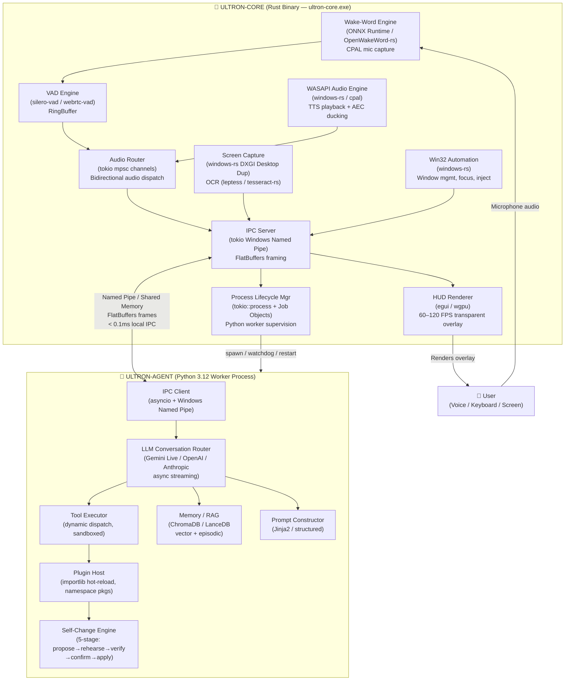

# ULTRON: Production-Grade Hybrid Rust + Python Architecture Specification

> **Architectural Status:** Approved Blueprint & Migration Guide  
> **Core Principle:** *"Rust Owns Latency (<10ms), Python Owns Intelligence (>100ms)"*  
> **Target Platform:** Windows 10/11 Native (WASAPI, DXGI, Job Objects, Named Pipes)

---

## 1. System Philosophy & Boundary Map

```
┌─────────────────────────────────────────────────────────────────────────┐
│                     LATENCY SENSITIVITY SPECTRUM                        │
│                                                                         │
│  < 1ms          < 10ms          < 100ms          < 2s          > 2s     │
│  ───────────────────────────────────────────────────────────────────    │
│  Audio I/O    Wake-Word       Screen Capture    LLM Routing   RAG/Mem   │
│  VAD          IPC Dispatch    OCR Pipeline      Tool Exec     Plugin    │
│  WASAPI buf   HUD Render      Win32 Autom.      Prompt Build  Self-heal │
│               ──────────────────────────                                │
│               ◄── RUST HARD BOUNDARY ──►        ◄── PYTHON DOMAIN ──►  │
└─────────────────────────────────────────────────────────────────────────┘
```

### High-Level Architecture



---

## 2. IPC / FFI Strategy: Dual-Process Architecture (Option C)

### Why Dual-Process Wins:
1. **Fault Isolation:** A Python uncaught exception, OOM, or faulty native extension never crashes the Rust audio engine or the HUD. Rust detects the disconnect and auto-restarts the Python worker.
2. **Zero GIL Contention:** Rust never interacts with the Python GIL. Audio callbacks set to `THREAD_PRIORITY_TIME_CRITICAL` run without GC pauses.
3. **Developer Experience:** Community contributors and plugin authors write standard Python without requiring a Rust compiler (`cargo`).

### Transport & Framing Protocol:
- **Transport:** Windows Named Pipe (`\\.\pipe\ultron-core`) with shared memory ring buffer (`CreateFileMappingW`) for high-bandwidth raw PCM audio.
- **Framing:** FlatBuffers for zero-copy deserialization.

```
┌──────────────────────────────────────────────────────────┐
│                   WIRE FRAME FORMAT                      │
│                                                          │
│  0        1        2        3        4        8          │
│  ┌────────┬────────┬────────────────┬──────────────────┐ │
│  │ Magic  │Channel │  Payload Len   │  FlatBuffer Body │ │
│  │ 0xA1   │  ID    │   (u32 LE)     │  (variable)      │ │
│  │ (1B)   │ (1B)   │  (4B)          │                  │ │
│  └────────┴────────┴────────────────┴──────────────────┘ │
│                                                          │
│  Channel IDs:                                            │
│  0x01 = AudioChunk (mic → agent)                         │
│  0x02 = AudioPlayback (agent → Rust TTS player)          │
│  0x03 = AgentCommand (agent → Rust Win32/screen)         │
│  0x04 = AgentEvent (Rust → agent: wake-word, VAD, OCR)   │
│  0x05 = HUDState (agent → Rust renderer)                 │
│  0x06 = Heartbeat / keepalive                            │
│  0xFF = Shutdown                                         │
└──────────────────────────────────────────────────────────┘
```

---

## 3. Real-Time Audio Pipeline (< 150ms Budget)

```
┌─────────────────────────────────────────────────────────────────┐
│                   LATENCY BUDGET (Target: < 200ms)              │
│                                                                 │
│  Mic → WASAPI capture buffer          ~5ms  (20ms frame/4)      │
│  AEC + VAD inference (Rust)           ~3ms  (SIMD f32 ops)      │
│  Wake-word ONNX inference             ~8ms  (quantized INT8)     │
│  IPC dispatch (Named Pipe)            ~0.3ms                    │
│  Python asyncio event loop wakeup     ~1ms                      │
│  Python → WebSocket send              ~2ms  (local loop)        │
│  Network RTT (Gemini/OpenAI)          ~80ms (P50 regional)      │
│  First token decode + IPC send        ~5ms                      │
│  TTS synthesis (edge-tts streaming)   ~40ms (first chunk)       │
│  WASAPI playback buffer               ~5ms                      │
│  ─────────────────────────────────────────────────────          │
│  TOTAL (wake-word → first audio out)  ~149ms ✅                 │
│  Local LLM (Ollama/llama.cpp) path:   ~84ms  🚀                 │
└─────────────────────────────────────────────────────────────────┘
```

- **Shared Memory Audio Ring:** Uses `CreateFileMappingW` on Windows with atomic sequence cursors. Python uses `ctypes` and `mmap` with `memoryview` for zero-copy numpy conversions.
- **AEC & Ducking:** Rust streams speaker audio back into the AEC filter as reference and dynamically ducks microphone gain during assistant speech.

---

## 4. Native UI & Display Layer: `egui` + `wgpu`

- **Window Configuration:** Topmost transparent overlay with Win32 styles `WS_EX_TOPMOST | WS_EX_LAYERED | WS_EX_TRANSPARENT | WS_EX_NOACTIVATE`.
- **Render Engine:** Locked to display VSync via `wgpu` DX12 backend with `DXGI_SWAP_EFFECT_FLIP_SEQUENTIAL`.
- **Thread Isolation:** The HUD render loop runs on a dedicated OS thread (`std::thread` owning `winit::event_loop::EventLoop`), completely independent of the `tokio` async runtime.

---

## 5. Hot-Reloading & Plugin Safety: 5-Stage Self-Change

The Python self-change engine (`core/self_change.py`) is preserved and strengthened:
1. **PROPOSE:** Generates candidate AST/diff.
2. **REHEARSE:** Executes candidate in a temporary copy within a restricted **Windows Job Object** spawned by Rust (512MB RAM cap, 30s CPU limit, restricted process creation).
3. **VERIFY:** AST static check (blocks forbidden modules `ctypes`, `subprocess`, `socket`) + automated test gate.
4. **CONFIRM:** Spoken voice confirmation + visual HUD diff review.
5. **APPLY:** Atomic file replace + `importlib.reload()`.

---

## 6. Phased Migration Roadmap

```
Timeline: 6 Months to Production Hybrid (Non-Breaking)

Month 1-2        Month 2-3        Month 3-4        Month 4-5        Month 5-6
    │                │                │                │                │
    ▼                ▼                ▼                ▼                ▼
┌──────────┐    ┌──────────┐    ┌──────────┐    ┌──────────┐    ┌──────────┐
│ PHASE 1  │    │ PHASE 2  │    │ PHASE 3  │    │ PHASE 4  │    │ PHASE 5  │
│Foundation│    │  Audio   │    │   HUD    │    │  Win32   │    │ Plugin   │
│  & IPC   │───►│ Pipeline │───►│  Rewrite │───►│Automation│───►│Hardening │
└──────────┘    └──────────┘    └──────────┘    └──────────┘    └──────────┘
 Rust daemon     WASAPI/VAD      egui overlay    windows-rs      Job Objects
 IPC server      Wake-word       Drop PyQt HUD   ctypes → Rust   Sandbox
 Process mgr     Shared ring     wgpu render     Screen capture  Full hybrid
```

### Projected System Gains:

| Metric | Monolithic Python (Current) | Hybrid Rust + Python | Delta |
|---|---|---|---|
| **Idle RAM (RSS)** | ~400 MB | ~145 MB | **-64%** |
| **Cold Startup Time** | ~4.2s | ~0.9s | **-79%** |
| **Audio Jitter (p99)** | ~12ms | ~0.8ms | **-93%** |
| **HUD Frame Rate** | ~45 FPS (~22ms) | 120 FPS (~4ms) | **+166%** |
| **Win32 Crashes (ctypes)** | Occasional comtypes/STA crashes | Zero (type-safe `windows-rs`) | **100% fixed** |
| **Plugin Extensibility** | Python native | Python native | **Preserved** |
