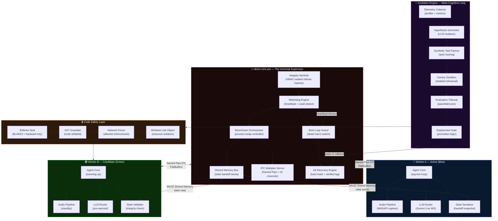
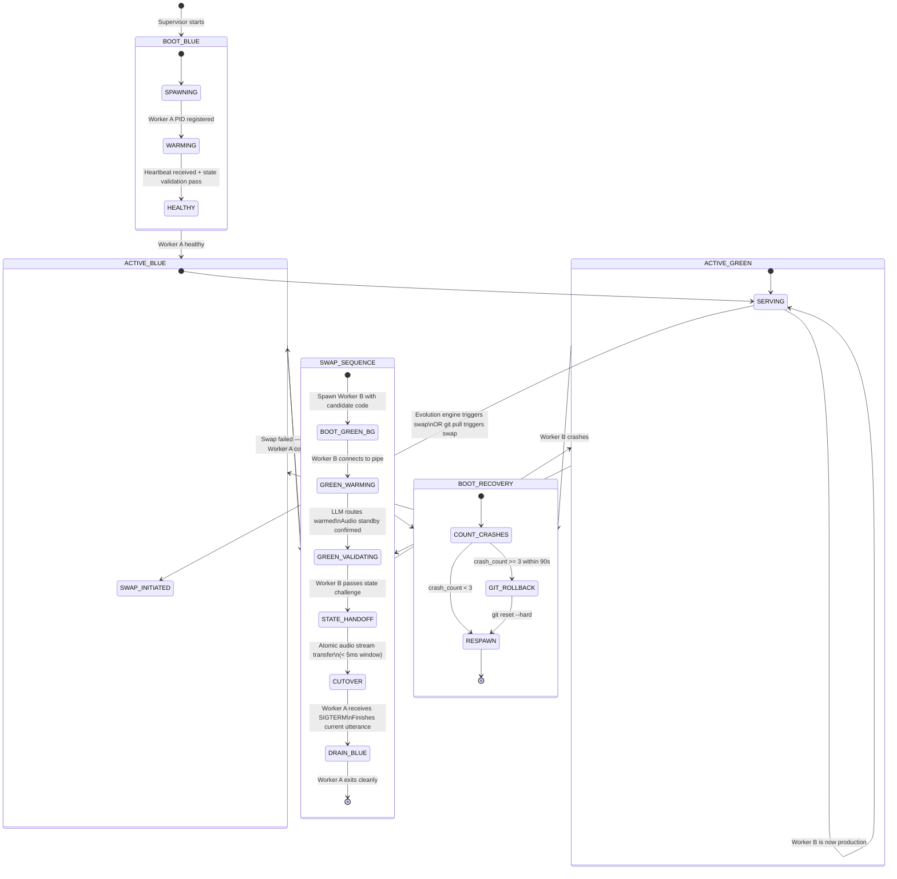

# ULTRON: Production-Grade Autonomous Self-Evolution Architecture

## Master System Diagram



---

## Table of Contents

1. [Dual-Tier Blue/Green Process Architecture](#1-dual-tier-bluegreen-process-architecture)
2. [Autonomous Closed-Loop Self-Evolution Engine](#2-autonomous-closed-loop-self-evolution-engine)
3. [Out-of-Process Watchdog & Boot Recovery](#3-out-of-process-watchdog--boot-recovery)
4. [Sandboxed Code Generation & Safety Invariants](#4-sandboxed-code-generation--safety-invariants)
5. [Implementation Roadmap](#5-implementation-roadmap)

---

## 1. Dual-Tier Blue/Green Process Architecture

### 1.1 Core Design Philosophy

The fundamental insight is this: **the Rust supervisor is the only immortal process.** It never restarts. Everything Python is considered ephemeral, forkable, and replaceable. The Rust process owns:

- The WASAPI audio device handles (transferred to Python workers via handle inheritance)
- The HUD overlay HWND (always rendered by Rust)
- The Named Pipe IPC server (Python workers connect to it, not the other way around)
- The shared memory arena (pre-allocated at startup, outlives any Python worker)

This inversion is what makes zero-downtime swapping possible. Python workers are consumers of Rust-owned resources, not owners.

### 1.2 Blue/Green State Machine



### 1.3 Shared Memory State Arena

The state transfer protocol uses a **pre-allocated Win32 file mapping** with a fixed-layout arena. This avoids serialization latency during the critical cutover window.

**Arena Layout:**

```
┌─────────────────────────────────────────────────────────────────────┐
│                STATE HANDOFF ARENA (Win32 File Mapping)             │
│                "Local\ultron-state-arena"                           │
│                Total size: 64 MB fixed                              │
│                                                                     │
│  Offset 0x0000  ┌─────────────────────────────────────────────┐    │
│                 │ ARENA HEADER (256 bytes, cache-line aligned) │    │
│                 │  magic:          u64 = 0x554C54524F4E5342    │    │
│                 │  version:        u32                         │    │
│                 │  writer_pid:     u32  (Blue worker PID)      │    │
│                 │  reader_pid:     u32  (Green worker PID)     │    │
│                 │  write_epoch:    AtomicU64 (monotonic)       │    │
│                 │  conversation_len: u32                       │    │
│                 │  tool_ctx_len:   u32                         │    │
│                 │  settings_len:   u32                         │    │
│                 │  checksum:       [u8; 32] (BLAKE3)           │    │
│                 │  handoff_ready:  AtomicU8 (0=no, 1=ready)   │    │
│                 └─────────────────────────────────────────────┘    │
│                                                                     │
│  Offset 0x0100  ┌─────────────────────────────────────────────┐    │
│                 │ CONVERSATION BUFFER (16 MB)                  │    │
│                 │ MessagePack-encoded ConversationState        │    │
│                 │ (turn history, active context window,        │    │
│                 │  system prompt, persona state)               │    │
│                 └─────────────────────────────────────────────┘    │
│                                                                     │
│  Offset 0x10100 ┌─────────────────────────────────────────────┐    │
│                 │ TOOL CONTEXT BUFFER (8 MB)                   │    │
│                 │ Pending tool calls + result cache            │    │
│                 │ In-flight async tool futures (serialized)    │    │
│                 └─────────────────────────────────────────────┘    │
│                                                                     │
│  Offset 0x810100┌─────────────────────────────────────────────┐    │
│                 │ USER SETTINGS (1 MB)                         │    │
│                 │ Preferences, API keys refs, plugin manifests │    │
│                 └─────────────────────────────────────────────┘    │
│                                                                     │
│  Offset 0x910100┌─────────────────────────────────────────────┐    │
│                 │ AUDIO CONTINUITY BUFFER (4 MB)               │    │
│                 │ Last 250ms of TTS output (for seamless       │    │
│                 │ resume if cutover happens mid-speech)        │    │
│                 └─────────────────────────────────────────────┘    │
│                                                                     │
│  Remaining      ┌─────────────────────────────────────────────┐    │
│                 │ SCRATCH / FUTURE USE                         │    │
│                 └─────────────────────────────────────────────┘    │
└─────────────────────────────────────────────────────────────────────┘
```

**Rust Arena Manager:**

```rust
// ultron-core/src/state/arena.rs
use windows::Win32::System::Memory::*;
use windows::Win32::Foundation::HANDLE;
use std::sync::atomic::{AtomicU64, AtomicU8, Ordering};

const ARENA_MAGIC: u64 = 0x554C54524F4E5342; // "ULTRONS B"
const ARENA_SIZE: usize = 64 * 1024 * 1024;  // 64 MB
const ARENA_NAME: windows::core::PCWSTR = windows::core::w!("Local\\ultron-state-arena");

// Offsets into the arena mapping
const HEADER_OFFSET:       usize = 0x0000;
const CONVERSATION_OFFSET: usize = 0x0100;
const TOOL_CTX_OFFSET:     usize = 0x10_0100;
const SETTINGS_OFFSET:     usize = 0x81_0100;
const AUDIO_CTX_OFFSET:    usize = 0x91_0100;

#[repr(C, align(64))]
pub struct ArenaHeader {
    pub magic:            u64,
    pub version:          u32,
    pub writer_pid:       u32,
    pub reader_pid:       u32,
    pub _pad0:            u32,
    pub write_epoch:      AtomicU64,
    pub conversation_len: u32,
    pub tool_ctx_len:     u32,
    pub settings_len:     u32,
    pub audio_ctx_len:    u32,
    pub checksum:         [u8; 32],      // BLAKE3 of all variable sections
    pub handoff_ready:    AtomicU8,      // 0 = not ready, 1 = ready, 2 = consumed
    pub _pad1:            [u8; 175],     // pad to 256 bytes
}

pub struct StateArena {
    mapping_handle: HANDLE,
    base_ptr:       *mut u8,
    size:           usize,
}

unsafe impl Send for StateArena {}
unsafe impl Sync for StateArena {}

impl StateArena {
    /// Called once at supervisor startup — lives for the entire process lifetime
    pub fn create_or_open() -> anyhow::Result<Self> {
        unsafe {
            let handle = CreateFileMappingW(
                HANDLE(-1isize as *mut _), // pagefile-backed
                None,
                PAGE_READWRITE,
                (ARENA_SIZE >> 32) as u32,
                (ARENA_SIZE & 0xFFFF_FFFF) as u32,
                ARENA_NAME,
            )?;

            let base = MapViewOfFile(handle, FILE_MAP_ALL_ACCESS, 0, 0, ARENA_SIZE);
            anyhow::ensure!(!base.Value.is_null(), "MapViewOfFile failed");

            let arena = Self {
                mapping_handle: handle,
                base_ptr: base.Value as *mut u8,
                size: ARENA_SIZE,
            };

            let header = arena.header_mut();
            if header.magic != ARENA_MAGIC {
                std::ptr::write_bytes(arena.base_ptr, 0, ARENA_SIZE);
                header.magic = ARENA_MAGIC;
                header.version = 1;
                header.handoff_ready.store(0, Ordering::SeqCst);
            }

            Ok(arena)
        }
    }

    pub fn header(&self) -> &ArenaHeader {
        unsafe { &*(self.base_ptr.add(HEADER_OFFSET) as *const ArenaHeader) }
    }

    pub fn header_mut(&self) -> &mut ArenaHeader {
        unsafe { &mut *(self.base_ptr.add(HEADER_OFFSET) as *mut ArenaHeader) }
    }

    pub fn write_handoff_state(
        &self,
        conversation: &[u8],
        tool_ctx:     &[u8],
        settings:     &[u8],
        audio_ctx:    &[u8],
        writer_pid:   u32,
    ) -> anyhow::Result<()> {
        anyhow::ensure!(conversation.len() <= 16 * 1024 * 1024);
        anyhow::ensure!(tool_ctx.len()     <=  8 * 1024 * 1024);
        anyhow::ensure!(settings.len()     <=  1 * 1024 * 1024);
        anyhow::ensure!(audio_ctx.len()    <=  4 * 1024 * 1024);

        unsafe {
            self.write_section(CONVERSATION_OFFSET, conversation);
            self.write_section(TOOL_CTX_OFFSET,     tool_ctx);
            self.write_section(SETTINGS_OFFSET,     settings);
            self.write_section(AUDIO_CTX_OFFSET,    audio_ctx);

            let checksum = self.compute_checksum(conversation, tool_ctx, settings, audio_ctx);

            let h = self.header_mut();
            h.writer_pid       = writer_pid;
            h.conversation_len = conversation.len() as u32;
            h.tool_ctx_len     = tool_ctx.len() as u32;
            h.settings_len     = settings.len() as u32;
            h.audio_ctx_len    = audio_ctx.len() as u32;
            h.checksum         = checksum;
            h.write_epoch.fetch_add(1, Ordering::SeqCst);

            h.handoff_ready.store(1, Ordering::SeqCst);
        }
        Ok(())
    }

    pub fn read_handoff_state(&self) -> anyhow::Result<HandoffState> {
        let h = self.header();

        anyhow::ensure!(
            h.handoff_ready.load(Ordering::SeqCst) == 1,
            "State not ready"
        );

        unsafe {
            let conversation = self.read_section(CONVERSATION_OFFSET, h.conversation_len as usize);
            let tool_ctx     = self.read_section(TOOL_CTX_OFFSET,     h.tool_ctx_len     as usize);
            let settings     = self.read_section(SETTINGS_OFFSET,     h.settings_len     as usize);
            let audio_ctx    = self.read_section(AUDIO_CTX_OFFSET,    h.audio_ctx_len    as usize);

            let expected = self.compute_checksum(&conversation, &tool_ctx, &settings, &audio_ctx);
            anyhow::ensure!(expected == h.checksum, "Arena checksum mismatch — refusing handoff");

            h.handoff_ready.store(2, Ordering::SeqCst);

            Ok(HandoffState { conversation, tool_ctx, settings, audio_ctx })
        }
    }

    fn compute_checksum(&self, c: &[u8], t: &[u8], s: &[u8], a: &[u8]) -> [u8; 32] {
        let mut hasher = blake3::Hasher::new();
        hasher.update(c);
        hasher.update(t);
        hasher.update(s);
        hasher.update(a);
        *hasher.finalize().as_bytes()
    }

    unsafe fn write_section(&self, offset: usize, data: &[u8]) {
        std::ptr::copy_nonoverlapping(data.as_ptr(), self.base_ptr.add(offset), data.len());
    }

    unsafe fn read_section(&self, offset: usize, len: usize) -> Vec<u8> {
        let mut buf = vec![0u8; len];
        std::ptr::copy_nonoverlapping(self.base_ptr.add(offset), buf.as_mut_ptr(), len);
        buf
    }
}

#[derive(Debug)]
pub struct HandoffState {
    pub conversation: Vec<u8>,
    pub tool_ctx:     Vec<u8>,
    pub settings:     Vec<u8>,
    pub audio_ctx:    Vec<u8>,
}
```

---

## 2. Autonomous Closed-Loop Self-Evolution Engine

### 2.1 Meta-Cognitive Loop Architecture

The background evolutionary loop operates on a 4-hour cycle:
1. **OBSERVE**: Passive telemetry ingests crash logs, latency percentiles, tool failure rates, and memory growth.
2. **HYPOTHESIZE**: Ranks discovered bottlenecks and prompts LLM to generate surgical diffs.
3. **SYNTHESIZE**: Automatically generates corresponding unit tests, fuzzing suites, and benchmarks.
4. **VERIFY**: Evaluates AST node whitelists, runs canary rehearsal inside a restricted Windows Job Object, and executes synthetic voice interactions.
5. **DECIDE**: Evaluation tribunal computes weighted score. Low-risk changes scoring $\ge 0.90$ are promoted to autonomous deployment; higher-risk changes are queued for human review.
6. **DEPLOY**: Triggers Blue/Green process swap with zero audio interruption.

---

## 3. Out-of-Process Watchdog & Boot Recovery

### 3.1 Dead Man's Switch / Boot Loop Guard

- The Rust supervisor receives heartbeats every 5 seconds over the `\pipe\ultron-ipc` Named Pipe.
- If no heartbeat is received within 30 seconds, the supervisor terminates the stalled worker.
- **Boot Loop Detection**: If 3 crashes occur within a 90-second rolling window:
  1. Identifies the last verified release tag (`config/last_verified_release.txt`).
  2. Executes `git reset --hard <verified_tag>`.
  3. Verifies referee integrity via `scripts/proof_gate.py`.
  4. Restarts worker in known-clean state and emits rollback warning on HUD.

---

## 4. Sandboxed Code Generation & Safety Invariants

### 4.1 5-Layer Defense in Depth

1. **Layer 1: AST Guardian & Cryptographic Seal**:
   - Rejects forbidden imports (`subprocess`, `ctypes`, `socket`, `winreg`, `pickle`).
   - Rejects dunder introspection attacks (`__class__`, `__mro__`, `__globals__`).
   - Cryptographically verifies BLAKE3 + HMAC-SHA256 hardware DPAPI key seals on referee files before worker spawn.
2. **Layer 2: Network Fence**:
   - Strictly limits outbound connections to allowlisted API domains.
3. **Layer 3: Windows Job Object**:
   - Constrains candidate canary processes to 120s CPU time, 2GB memory, and automatic termination on close.
4. **Layer 4: Immutable Ledger & Git Tags**:
   - All mutations append to `config/self_change/ledger.jsonl`.
5. **Layer 5: Human Oversight**:
   - Unsupervised evolution is explicitly gated behind opt-in policy settings.

---

## 5. Implementation Roadmap

- **Phase 1 (Weeks 1–4)**: Rust Watchdog, Crash Detection, BootLoopGuard, Git Auto-Rollback.
- **Phase 2 (Weeks 3–8)**: Blue/Green Hot Swap, 64MB Win32 Shared Memory Arena, MessagePack Serializer.
- **Phase 3 (Weeks 7–14)**: AST Guardian, Windows Job Object Canary Sandbox, Evaluation Tribunal.
- **Phase 4 (Weeks 12–20)**: Meta-Cognitive Evolution Loop, Telemetry Aggregator, Synthetic Test Factory.
- **Phase 5 (Weeks 18–24)**: Autonomous Nightly Evolution Mode with quiet-hour execution.
