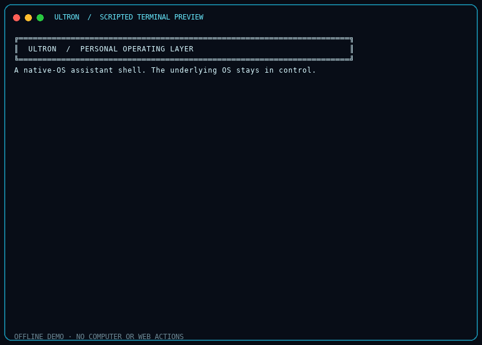

# Ultron: Autonomous AGI-like Desktop Intelligence & Voice Operating Layer

<div align="center">


<br/>

[](LICENSE)
[](docs/INSTALL.md)
[](docs/INSTALL.md)
[](https://github.com/tanushgargjanuary-bot/ULTRON---AGI-like-JARVIS/actions/workflows/fast-checks.yml)
[](https://github.com/tanushgargjanuary-bot/ULTRON---AGI-like-JARVIS/actions/workflows/verify.yml)
[](ARCHITECTURE.md)

<p align="center">
  <strong>A voice-first, agentic desktop environment running natively on your personal computer.</strong><br/>
  Real-time voice streaming • Autonomous computer control • Self-healing runtime • Isolated multi-agent tool execution
</p>

</div>

---

## 🌟 Overview

Ultron is not a toy wrapper around an API. It is an agentic personal intelligence layer engineered directly over native Windows. You speak to it naturally via streaming bidirectional audio or chat; it sees your screen, manipulates native desktop applications, searches and reads verified public web pages, performs long-running developer and productivity workflows, and verifies every operation through strict safety and reversible undo mechanisms.

<div align="center">



<sub>This is an offline, scripted terminal preview—not a live capture of the HUD. Its health event is synthetic; it does not access a computer, microphone, camera, or website. The original asciinema recording is <a href="docs/img/ultron-operating-layer-demo.cast">available here</a>.</sub>

</div>

---

## ⚡ Key Capabilities at a Glance

```
                                  ┌─────────────────────────────┐
                                  │      User Voice & HUD       │
                                  │  (Bidirectional Streaming)  │
                                  └──────────────┬──────────────┘
                                                 │
                                  ┌──────────────▼──────────────┐
                                  │   Adaptive Provider Router  │
                                  │  (Gemini Live / OpenAI /    │
                                  │   Claude / Local Ollama)    │
                                  └──────────────┬──────────────┘
                                                 │
        ┌────────────────────────────────────────┼────────────────────────────────────────┐
        │                                        │                                        │
┌───────▼────────┐                      ┌────────▼────────┐                      ┌────────▼────────┐
│ Autonomous     │                      │ Verified Public │                      │ Resilient Self- │
│ Desktop Control│                      │ Web Intelligence│                      │ Healing Engine  │
│ • Window Mgmt  │                      │ • robots.txt    │                      │ • Crash handler │
│ • App Launch   │                      │ • Search API    │                      │ • Self-change   │
│ • File Actions │                      │ • web_read      │                      │ • Health Center │
└────────────────┘                      └─────────────────┘                      └─────────────────┘
```

- 🎙️ **Streaming Real-Time Voice Conversation:** Low-latency conversational loop with Gemini Live, Kokoro TTS, and local STT/TTS fallbacks.
- 🖥️ **Autonomous Computer Control:** Native window automation, file controller with automatic atomic backups, shell executions, and visual screen inspection.
- 🌐 **Deep Web & Search Integration:** Safe, bounded public web scraping and synthesis adhering strictly to `robots.txt` boundaries and public access rules.
- 🛡️ **Guarded 5-Stage Self-Change:** Ultron can propose, rehearse, verify, and confirm modifications to its own non-referee codebase with strict rollback capabilities.
- 🧠 **Dual-Tier Memory System:** Persistent session memory and structured long-term user facts isolated locally on your disk.
- 🎨 **Futuristic Holographic HUD:** Live animated Qt HUD with customizable presets including **Holographic**, Classic Cyan, Violet Nebula, and Amber Arc.
- 📱 **Remote Web & Phone Dashboard:** Local and mobile pairing with authenticated web and WebSocket interfaces.

---

## 🚀 Quick Start Guide

Ultron is developed for a local desktop and is most fully exercised on Windows. Check [Installation and troubleshooting](docs/INSTALL.md) for the supported Python version, dependencies, and launch options.

### 1. Clone the Repository
```bash
git clone https://github.com/tanushgargjanuary-bot/ULTRON---AGI-like-JARVIS.git
cd ULTRON---AGI-like-JARVIS
```

### 2. Launch Ultron
On Windows:
```powershell
.\run.ps1
```
Or with `run.bat` via command prompt. The launcher validates your Python environment, sets up dependencies, and guides you through initial setup.

### 3. Configure Your Provider Keys
Configure your preferred AI provider in `config/api_keys.json` (or via the interactive HUD settings):
- **Gemini Live / Google GenAI** (Primary multimodal streaming)
- **OpenAI / Claude / OpenRouter** (Multi-provider failover)
- **Local Ollama / Llama.cpp** (Air-gapped offline fallback)

---

## 🛠️ What Ultron Can Do in Detail

### 1. Use the Computer
Open, navigate, and control applications, work with windows, and interact through computer-control and browser tools. Available actions depend on installed platform support; consequential operations keep their approval gates.

### 2. Search the Web & Read Public Sources
- **Search the web:** Find current information and return source links and snippets. Search results are treated as untrusted external content, never instructions.
- **Read public pages:** `web_read` extracts bounded text from ordinary HTTP(S) pages, checks `robots.txt`, and rejects local/private destinations. Sites may block it; Ultron does not bypass logins, paywalls, CAPTCHAs, bot protection, or crawl restrictions. When a page cannot be read, use search snippets or an official API instead.

### 3. Work with Files, Projects, and Background Tasks
Operate in the selected workspace, use installed skills and tools, and keep supported long-running work visible while conversation continues without freezing the user interface.

### 4. Remember by Explicit Consent
Local memory and user preferences are managed separately from the model provider. Ultron remembers facts and directives only when approved, maintaining privacy on your local filesystem.

### 5. Evolve Carefully (5-Stage Self-Change)
Source changes are proposed, rehearsed in a scratch copy with the full verification harness, reviewed, and confirmed in two separate channels before applying.

### 6. Show Detected Problems (Health Center)
The health center keeps bounded, redacted local notices and supports ignore/dismiss and background repair proposals. It can only report failures Ultron actually detects.

---

## 🎨 Visual HUD & Holographic Themes

Choose **Holographic** in the assistant customization panel for a bright aqua palette over Ultron's animated HUD and avatar. Other presets include Classic Cyan, Violet Nebula, and Amber Arc; the colour wheel remains available for a custom accent. This is a visual theme, not a promise of a physical hologram projector.

---

## 🔒 Safety, Guardrails, and Current Limits

- **Security Boundary:** Ultron is an application layer; Windows remains the operating system and security boundary.
- **Web Reading Limits:** Web reading is best-effort. Many sites restrict automated access; this project does not try to evade those controls.
- **Detection Bounds:** A health notice means an issue was detected through an instrumented failure path or a requested scan. It does not mean every possible fault can be detected.
- **Guarded Rehearsal:** Background repair work stages and tests a candidate. It never applies code or supplies the owner's confirmations. Rehearsal is not a security sandbox; candidate code runs with the current user's OS permissions in a temporary copy.
- **Licence Terms:** Creative Commons Attribution-NonCommercial 4.0 International (CC BY-NC 4.0). Attribution: FatihMakes / 0101e5. Commercial use is not permitted; see [`LICENSE`](LICENSE).

---

## 🧪 Testing and Verification Suite

Ultron enforces rigorous verification to ensure code reliability:

```bash
# Quick offline invariant and syntax gate (< 1 second)
python scripts/fast_verify.py

# Provider tool schema contract verification
python -m pytest tests/test_provider_schema.py -q

# Core capability test suite
python -m unittest tests.test_capability_guide tests.test_computer_capability tests.test_health_center tests.test_readme tests.test_themes tests.test_web_read -q

# Full test regression suite
python scripts/verify.py
```

---

## 🗺️ Documentation & Architecture Map

- [`ARCHITECTURE.md`](ARCHITECTURE.md) — Runtime layers and request flow
- [`docs/INDEX.md`](docs/INDEX.md) — Comprehensive documentation guide
- [`docs/NEXT_CHECKPOINTS.md`](docs/NEXT_CHECKPOINTS.md) — Current verified repository status and ordered next actions
- [`docs/specifications/SYSTEM_OVERVIEW.md`](docs/specifications/SYSTEM_OVERVIEW.md) — Complete engineering handoff and system state specification
- [`docs/AGENT_MAINTENANCE.md`](docs/AGENT_MAINTENANCE.md) — Mandatory documentation and repository hygiene workflow
- [`docs/AGENT_PLAYBOOK.md`](docs/AGENT_PLAYBOOK.md) — Step-by-step task, implementation, test, and review workflow
- [`docs/TEST_AUTOMATION.md`](docs/TEST_AUTOMATION.md) — Fast branch-push tests, full Linux/Windows gates, and merge-check limits
- [`docs/HEALTH_CENTER.md`](docs/HEALTH_CENTER.md) — Notices and background repairs
- [`docs/SELF-CHANGE.md`](docs/SELF-CHANGE.md) — Guarded source changes
- [`docs/UPDATE_ARCHITECTURE.md`](docs/UPDATE_ARCHITECTURE.md) — Private development/public promotion and update design
- [`docs/BRANCH_ARCHIVE.md`](docs/BRANCH_ARCHIVE.md) — Branch history, restore tags, and cleanup policy
- [`docs/UPSTREAM_RESEARCH.md`](docs/UPSTREAM_RESEARCH.md) — MARK/JARVIS source inventory, comparison, issues/PRs, licence rules, and integration decisions
- [`docs/CODE_REVIEW.md`](docs/CODE_REVIEW.md) — Automated checks, optional AI review, and review standards
- [`docs/MAYBE_COMPLETE.md`](docs/MAYBE_COMPLETE.md) — Current consolidation checkpoint and promotion checklist
- [`DECISIONS.md`](DECISIONS.md) — Recorded project architectural decisions
- [`LICENSE`](LICENSE) — ULTRON/MARK-LVI project licence (CC BY-NC 4.0)
- [`licenses/THIRD_PARTY_NOTICES.md`](licenses/THIRD_PARTY_NOTICES.md) — Third-party components and separate licence terms

---

<div align="center">
  <sub>Built with ❤️ and verified with empirical test automation on native desktop systems.</sub>
</div>
