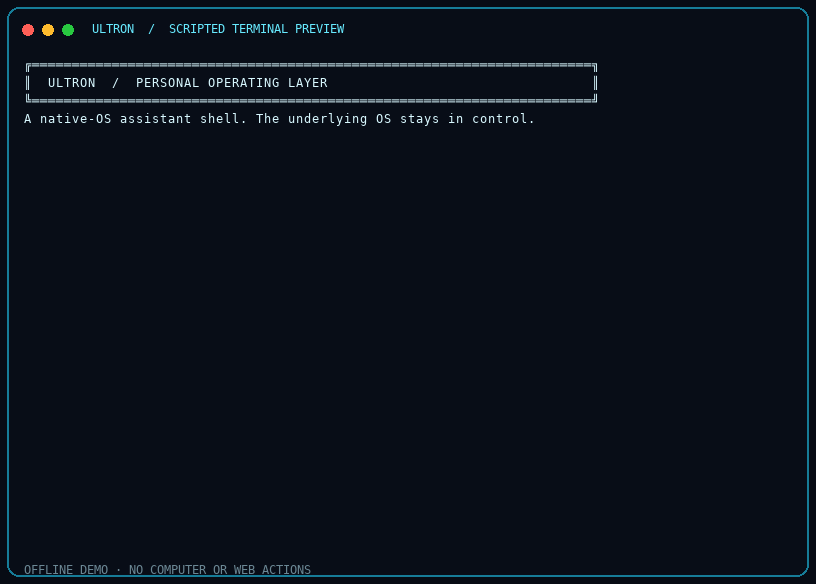

# Ultron

**A voice-first, agentic desktop environment that runs on your native operating system.**

Ultron is not a replacement kernel or a new operating system. It is a personal control layer over Windows: you talk to it, it can use approved desktop tools, search and read public web pages, run background jobs, and keep the work visible and reversible.



<sub>This is an offline, scripted terminal preview—not a live capture of the HUD. Its health event is synthetic; it does not access a computer, microphone, camera, or website. The original asciinema recording is <a href="docs/img/ultron-operating-layer-demo.cast">available here</a>.</sub>


## What Ultron can do

- **Use the computer:** open and control applications, work with windows, and interact through computer-control and browser tools. Available actions depend on installed platform support; consequential operations keep their approval gates.
- **Search the web:** find current information and return source links/snippets. Search results are untrusted external content, not instructions.
- **Read public pages:** `web_read` extracts bounded text from ordinary HTTP(S) pages, checks `robots.txt`, and rejects local/private destinations. Sites may block it; Ultron does not bypass logins, paywalls, CAPTCHAs, bot protection, or crawl restrictions. When a page cannot be read, use search snippets or an official API instead.
- **Work with files and tasks:** operate in the selected workspace, use installed skills/tools, and keep supported long-running work visible while conversation continues.
- **Remember by consent:** local memory and preferences are managed separately from the model provider.
- **Evolve carefully:** source changes are proposed, rehearsed in a scratch copy with the full verification harness, reviewed, and confirmed in two separate channels before applying.
- **Show detected problems:** the health center keeps bounded, redacted local notices and supports ignore/dismiss and background repair proposals. It can only report failures Ultron actually detects.

## Holographic look

Choose **Holographic** in the assistant customization panel for a bright aqua palette over Ultron's animated HUD/avatar. Other presets include Classic Cyan, Violet Nebula, and Amber Arc; the colour wheel remains available for a custom accent. This is a visual theme, not a promise of a physical hologram projector.

## Get started

Ultron is developed for a local desktop and is most fully exercised on Windows. Check [Installation and troubleshooting](docs/INSTALL.md) for the supported Python version, dependencies, and launch options.

1. Clone or download this repository.
2. Run `run.bat` or `run.ps1` on Windows and follow setup prompts.
3. Configure the model/provider you want to use. Keep credentials in local configuration or the operating system's credential store—never commit them.

Some abilities are optional. If a dependency or integration is unavailable, Ultron should say so rather than claim it worked. Screen, camera, and system actions remain subject to local permissions and platform support.

## Safety and current limits

- Ultron is an application layer; Windows remains the operating system and security boundary.
- Web reading is best-effort. Many sites restrict automated access; this project does not try to evade those controls.
- A health notice means an issue was detected through an instrumented failure path or a requested scan. It does not mean every possible fault can be detected.
- Background repair work stages and tests a candidate. It never applies code or supplies the owner's confirmations.
- **Rehearsal is not a security sandbox.** Candidate code runs with the current user's OS permissions, even in a temporary copy. Only rehearse trusted code; do not treat this as isolation from hostile code.
- The signed release verifier is not yet wired into a complete publisher/downloader and safe core-update handoff. Do not enable unattended core-code updates.
- Private owner-development and canary publishing are not configured. This public repository remains the curated/professional upstream.
- **License:** Creative Commons Attribution-NonCommercial 4.0 International (CC BY-NC 4.0). Attribution: FatihMakes / 0101e5. Commercial use is not permitted; see [`LICENSE`](LICENSE).

## Development

```bash
python -m unittest tests.test_capability_guide tests.test_computer_capability tests.test_health_center tests.test_readme tests.test_themes tests.test_web_read -q
python scripts/verify.py
```

Run `python scripts/fast_verify.py` for the quick offline preflight. Run `python scripts/verify.py` for the full regression suite. The focused command above is a smaller feature-specific test sample. The full project verification may require platform or optional packages; run it in the intended installation environment before promoting a change.

### Branch workflow and automatic tests

- `main` is the only permanent integration branch. Main-only work is the default for small, low-risk, non-parallel changes when the owner authorizes it.
- Use a short-lived `feature/<topic>` or `fix/<topic>` branch only when isolation, parallel work, or rollback risk gives a clear benefit. Do not keep permanent branches per agent or model.
- Every branch push runs the fast offline test gate. Pull requests to `main` and pushes to `main` also run the full Linux/Windows regression gate.
- **Merge enforcement is not verified.** The available GitHub integration returned HTTP 403 when reading `main` branch protection. Configure the fast, Linux, and Windows jobs as required checks and verify the settings in GitHub. See [Test automation](docs/TEST_AUTOMATION.md).
- Run `python scripts/fast_verify.py` for quick local checks and `python scripts/verify.py` for the full suite.
- See [Test automation](docs/TEST_AUTOMATION.md) and [Code review](docs/CODE_REVIEW.md).
- Historical branch tips remain as protected exact-SHA archive tags. Do not delete or move these tags as routine cleanup. See [Branch archive and cleanup](docs/BRANCH_ARCHIVE.md).
- Every medium or large change must follow the [Agent maintenance system](docs/AGENT_MAINTENANCE.md), including documentation updates, handoff maintenance, safe cleanup, and structure checks.

To reproduce the terminal demo GIF (requires the optional demo tools):

```bash
python -m pip install -r requirements-demo.txt
asciinema rec --cols 96 --rows 28 \
  -c "python -m scripts.readme_demo" docs/img/ultron-operating-layer-demo.cast
python scripts/render_asciinema_gif.py \
  docs/img/ultron-operating-layer-demo.cast docs/img/ultron-operating-layer-demo.gif
```

The demo script is deterministic and offline. It creates only a temporary synthetic health notice; it does not run real desktop or web actions.

## Project map

- [`ARCHITECTURE.md`](ARCHITECTURE.md) — runtime layers and request flow
- [`docs/INDEX.md`](docs/INDEX.md) — documentation guide
- [`docs/NEXT_CHECKPOINTS.md`](docs/NEXT_CHECKPOINTS.md) — current verified repository status and ordered next actions
- [`OwnerFiles/ULTIMATE_Context.md`](OwnerFiles/ULTIMATE_Context.md) — complete handoff for a new chat or agent
- [`docs/AGENT_MAINTENANCE.md`](docs/AGENT_MAINTENANCE.md) — mandatory documentation and repository hygiene workflow
- [`docs/HEALTH_CENTER.md`](docs/HEALTH_CENTER.md) — notices and background repairs
- [`docs/SELF-CHANGE.md`](docs/SELF-CHANGE.md) — guarded source changes
- [`docs/UPDATE_ARCHITECTURE.md`](docs/UPDATE_ARCHITECTURE.md) — private development/public promotion and update design
- [`docs/BRANCH_ARCHIVE.md`](docs/BRANCH_ARCHIVE.md) — branch history, restore tags, and cleanup policy
- [`docs/UPSTREAM_RESEARCH.md`](docs/UPSTREAM_RESEARCH.md) — MARK/JARVIS source inventory, comparison, issues/PRs, licence rules, and integration decisions
- [`docs/CODE_REVIEW.md`](docs/CODE_REVIEW.md) — automated checks, optional AI review, and review standards
- [`docs/MAYBE_COMPLETE.md`](docs/MAYBE_COMPLETE.md) — current consolidation checkpoint and promotion checklist
- [`DECISIONS.md`](DECISIONS.md) — recorded project decisions
- [`LICENSE`](LICENSE) — ULTRON/MARK-LVI project licence (CC BY-NC 4.0)
- [`licenses/THIRD_PARTY_NOTICES.md`](licenses/THIRD_PARTY_NOTICES.md) — third-party components and separate licence terms
